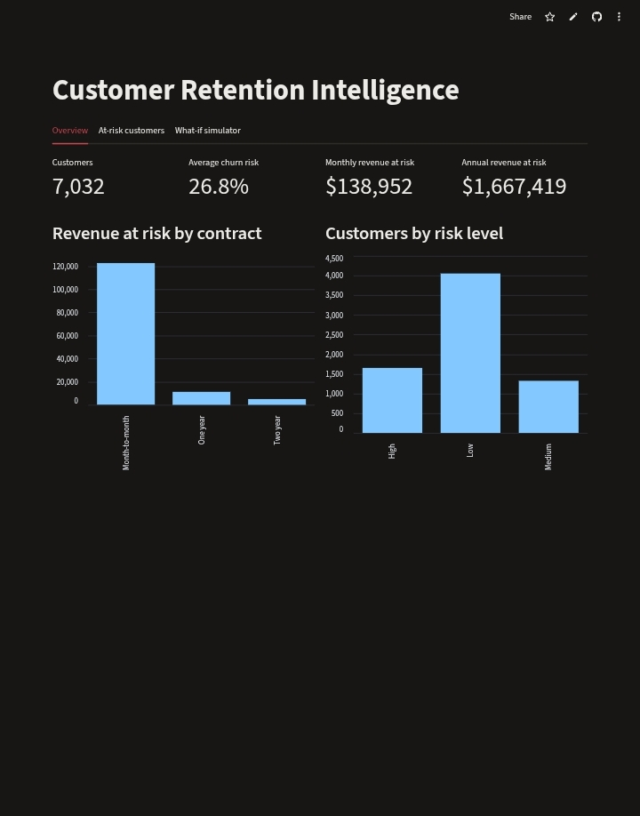
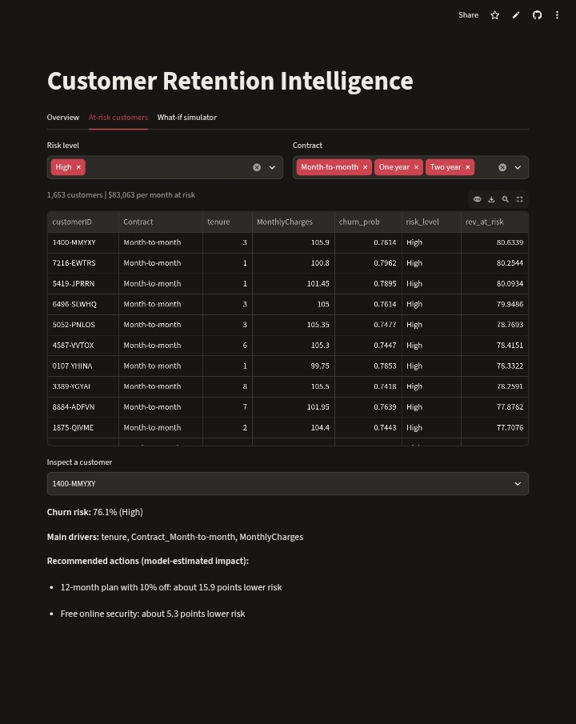
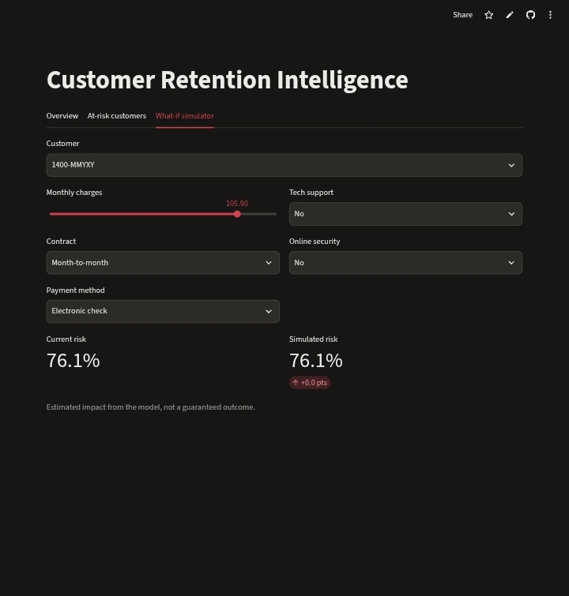

# Customer Retention Intelligence System

An AI-powered system that predicts which telecom customers are likely to churn, explains why, ranks them by revenue at risk, and recommends specific retention actions.

**Live demo:** https://churn-retention-by2zm3c5sphfh64blw4ld4.streamlit.app/

<!-- Add screenshots here: Overview, At-risk customers, What-if simulator -->








## What it does

- **Churn prediction:** calibrated probability of churn for every customer.
- **Risk scoring:** Low (up to 25%), Medium (25% to 50%), High (above 50%).
- **Explanations:** SHAP identifies the top factors driving each customer's risk.
- **Personalised retention assistant:** recommends the two actions with the largest estimated risk reduction for each at-risk customer, instead of generic advice.
- **What-if simulator:** change monthly charges, contract type, payment method, tech support or online security and see the predicted change in risk.
- **Revenue at risk:** churn probability multiplied by monthly charges, summed by segment, shown monthly and annually.
- **REST API:** FastAPI endpoints for prediction, recommendations, simulation and revenue at risk.

## Dataset

IBM Telco Customer Churn: 7,043 customers, 21 columns, about 26.6% churn. After removing 11 rows with blank `TotalCharges`, 7,032 customers remain.

## Method

1. Cleaned the data (numeric conversion of `TotalCharges`, dropped `customerID`, encoded the target) and explored churn by contract, internet service and payment method.
2. Stratified 80/20 train/test split. Encoding and scaling are inside a scikit-learn pipeline to prevent leakage.
3. Trained Logistic Regression, Random Forest and XGBoost with class weighting for the imbalance.
4. Tuned XGBoost with randomized search (5-fold stratified CV, optimising ROC-AUC).
5. Chose a decision threshold from a precision/recall trade-off table.
6. Calibrated the probabilities (sigmoid) so that risk scores and revenue figures are on a realistic scale.
7. Added SHAP explanations, rule-based actions ranked by simulated impact, and the dashboard and API.

## Results

Baseline model comparison (test set, default 0.50 threshold):

| Model | Precision | Recall | F1 | ROC-AUC |
|---|---|---|---|---|
| Logistic Regression | 0.536 | 0.719 | 0.614 | 0.840 |
| Random Forest | 0.623 | 0.540 | 0.579 | 0.826 |
| XGBoost | 0.521 | 0.773 | 0.622 | 0.842 |

XGBoost was selected for the best recall and AUC. After tuning, cross-validated ROC-AUC was 0.851.

Tuned XGBoost threshold trade-off (test set):

| Threshold | Precision | Recall | F1 |
|---|---|---|---|
| 0.45 | 0.486 | 0.824 | 0.611 |
| 0.50 | 0.508 | 0.802 | 0.622 |
| 0.60 | 0.571 | 0.719 | 0.637 |

The best threshold depends on the cost of a retention offer compared with the revenue of a retained customer. A lower threshold catches more churners but wastes more offers.

Calibration: the class-weighted model overestimated risk (about $211k monthly revenue at risk). After calibration, average predicted risk is 26.8% against an actual churn rate of 26.6%, and monthly revenue at risk is about $139k.

## Project structure

```
app.py            FastAPI backend and shared model logic
dashboard.py      Streamlit dashboard
train.py          Rebuilds the model files from the dataset
requirements.txt  Dependencies
```

## Run locally

```bash
pip install -r requirements.txt
python train.py                # creates the two .joblib model files
streamlit run dashboard.py     # dashboard
uvicorn app:app --reload       # API, docs at http://127.0.0.1:8000/docs
```

## API endpoints

| Endpoint | Purpose |
|---|---|
| `GET /health` | Health check |
| `POST /predict` | Churn probability, risk level, top reasons |
| `POST /recommend` | Top two ranked retention actions |
| `POST /simulate` | Before and after risk for changed fields |
| `POST /revenue-at-risk` | Revenue at risk for a list of customers |

## Limitations

- **Estimated impacts are not causal.** The model learned correlations. For example, long-contract customers churn less, but that does not prove that moving someone to a long contract will keep them. Action impacts and the what-if simulator show model estimates only, and the effect of changing contract type is probably overstated.
- **Actions are business rules.** Offers such as a 10% discount and their assumed effects are illustrative and should be tested with A/B experiments.
- **Scoring includes training data.** The dashboard scores all customers, including those the model trained on, so individual scores look slightly more confident than they would on new customers. Quote the test-set metrics for performance.
- **Threshold chosen on the test set**, which is slightly optimistic. A separate validation set would be better.
- **Single public dataset.** It is a static snapshot with no time dimension, so it cannot capture seasonality or changing behaviour.
- **SHAP drivers come from the uncalibrated model.** They show which factors matter, not exact probability changes.

## Future work

- Validate recommendations with A/B tests or uplift modelling.
- Add a cost-benefit view that nets offer cost against expected saved revenue.
- Monitor model drift and retrain on fresh data.
- Deploy the API separately (for example on Render) and connect the dashboard to it.

## Tech stack

Python, pandas, scikit-learn, XGBoost, SHAP, FastAPI, Streamlit.
